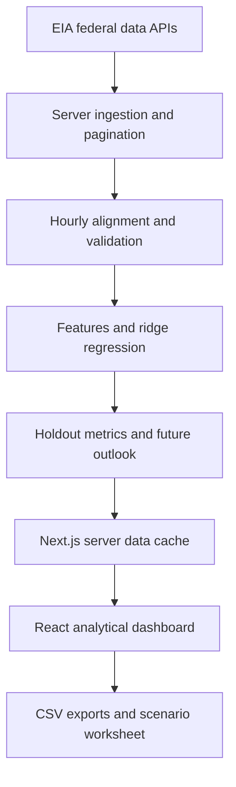

# GridLens — U.S. Grid Intelligence

**Live electricity analytics, demand forecasting, and scenario planning built by Fadil Mohammed Surur.**

[Open the deployed app](https://gridlens-fadil.blushreed33.chatgpt.site) · [Architecture](docs/ARCHITECTURE.md) · [Model methodology](docs/MODEL_CARD.md) · [Local setup](docs/SETUP.md) · [Validation](docs/VALIDATION.md) · [API reference](docs/API.md) · [Vercel deployment](docs/VERCEL.md)

> **Deployment status:** This branch is prepared for Vercel. The demo link above is the existing owner-private Sites deployment; it is not a Vercel deployment URL. See [VERCEL.md](docs/VERCEL.md) for the remaining account configuration.

## The problem

Grid analysts need to understand changing electricity demand, assess whether a forecast is useful, and translate uncertainty into planning assumptions. Scattered federal datasets and isolated model metrics make those questions difficult to explore together.

GridLens connects live EIA observations to an interactive analytical workspace. Users can compare forecasts on matching test hours, investigate state energy economics, and export a transparent demand-stress worksheet.

## Product walkthrough

| Workspace | What it helps answer |
| --- | --- |
| **Overview** | How does observed demand compare with EIA forecasts? Is the data fresh and complete? |
| **Forecast lab** | Does ridge regression outperform a seasonal baseline and EIA on the same unseen hours? |
| **Energy transition** | How do selected renewable-generation shares and residential prices vary across states? |
| **Decision studio** | How does an assumed demand stress change the projected peak and additional planning buffer? |
| **About the project** | Where do the data come from, how is the model evaluated, and what are the limits? |

## Demonstrated results

Production endpoint checks completed on **October 11, 2026**:

- All **10 balancing authorities** returned live data, evaluation metrics and **24 hourly forecast estimates**.
- State economics returned **50 states plus D.C.** for calendar year 2025.
- PJM analysis aligned **1,440 hourly positions** from **5,710 API records**, with **168 paired held-out hours**.

| PJM method | MAE · MW | RMSE · MW | MAPE |
| --- | ---: | ---: | ---: |
| Ridge regression | 1,686.56 | 2,031.27 | 1.99% |
| EIA day-ahead forecast | 1,968.40 | 2,503.61 | 2.41% |
| Previous-week seasonal baseline | 5,309.97 | 7,157.11 | 6.13% |

These are results from one retrospective run, not guarantees across authorities or dates. The learned model is evaluated **one hour ahead with observed historical lags**; EIA's forecast has a different forecast issuance horizon. The comparison is informative but does not establish superiority at equal operational lead time. The dashboard recalculates results from retrieved data. See the [model card](docs/MODEL_CARD.md).

## Architecture



**Stack:** React 19, TypeScript, Next.js, Recharts, server API routes, Vercel Node.js functions and the Next.js server data cache. The forecasting implementation uses an explicit numerical ridge solver, making feature generation, fitting and evaluation inspectable in code.

## Engineering features

- Server-side EIA credentials; the browser never receives the API key.
- Paginated ingestion, bounded retry attempts and explicit API error states.
- Hourly UTC alignment with missing observations retained.
- Server-cached analytical payloads with ten-minute revalidation for grid analysis and one-day revalidation for state economics.
- Chronological holdout evaluation on the same valid pairs across three methods.
- Separate earlier calibration fitting and empirical uncertainty bands.
- Recursive next-24-hour forecasting after refitting on retrieved observations.
- CSV exports, authority filters, state filters and demand-stress controls.
- Offline verification scripts and GitHub Actions checks.

## Run locally

Requires Node.js **22.13 or later**, pnpm **11.25.0**, and an EIA API key.

```bash
pnpm install --frozen-lockfile
cp .env.example .env.local
# Set EIA_API_KEY privately in .env.local.
pnpm dev
```

Open `http://localhost:3000`. No separate database or schema migration is required on this branch. See [SETUP.md](docs/SETUP.md) and [VERCEL.md](docs/VERCEL.md).

## Verify

```bash
pnpm typecheck
pnpm test
pnpm build
# Optional network-dependent integration checks:
pnpm test:live
node tests/energy.mjs
```

Offline checks use deterministic test fixtures, never presented as live product data. Live checks use EIA's public demonstration credential and can fail due to upstream availability or rate limits. CI deliberately runs offline checks and the build only.

## Scope

This is a deployed analytical prototype, not a grid control or dispatch system. It does not claim weather-aware forecasts, automatic scheduling, a historical warehouse, outage modeling, transmission constraints, causal price effects or guaranteed uncertainty coverage. Data are refreshed on demand. See [DATA_SOURCES.md](docs/DATA_SOURCES.md) and [MODEL_CARD.md](docs/MODEL_CARD.md).

## Repository guide

```text
app/                  Dashboard, layout, and server API routes
lib/forecast.ts       Feature engineering, ridge fit and evaluation
lib/eia.ts            Server-side EIA client and short-lived memory cache
tests/               Offline checks and optional live integration checks
docs/                Setup, architecture, model, data and validation docs
vercel.json          Vercel framework configuration
.github/workflows/   Continuous integration
```

The Vercel branch removes Cloudflare-specific runtime integrations. Product logic is concentrated in `app/`, `lib/forecast.ts` and `lib/eia.ts`.

## Attribution

Inspired by **Lumina** by **Aditya Kanbargi and Sanjana Muralidhar**: [original repository](https://github.com/adikan2k/Lumina-Real-Time-U.S.-Grid-Intelligence-Demand-Forecasting). GridLens is an independent full-stack implementation with its own dashboard, server integration, model evaluation and planning controls. Public data come from the [U.S. Energy Information Administration](https://www.eia.gov/opendata/).

Third-party packages and retained starter assets keep their respective licenses. See [THIRD_PARTY_NOTICES.md](THIRD_PARTY_NOTICES.md). No root-level redistribution license is asserted by this repository.
